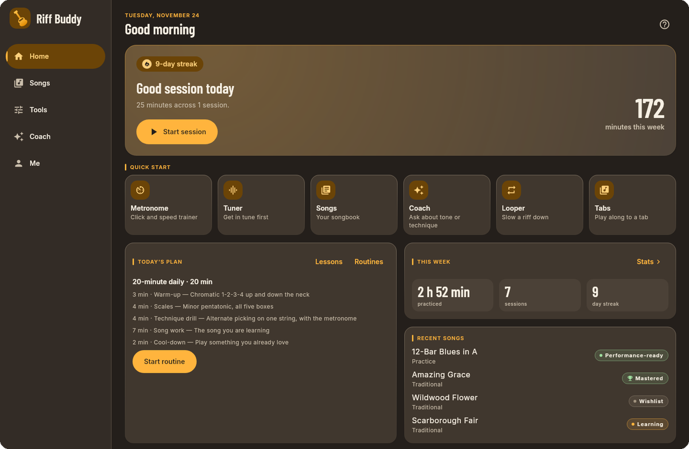
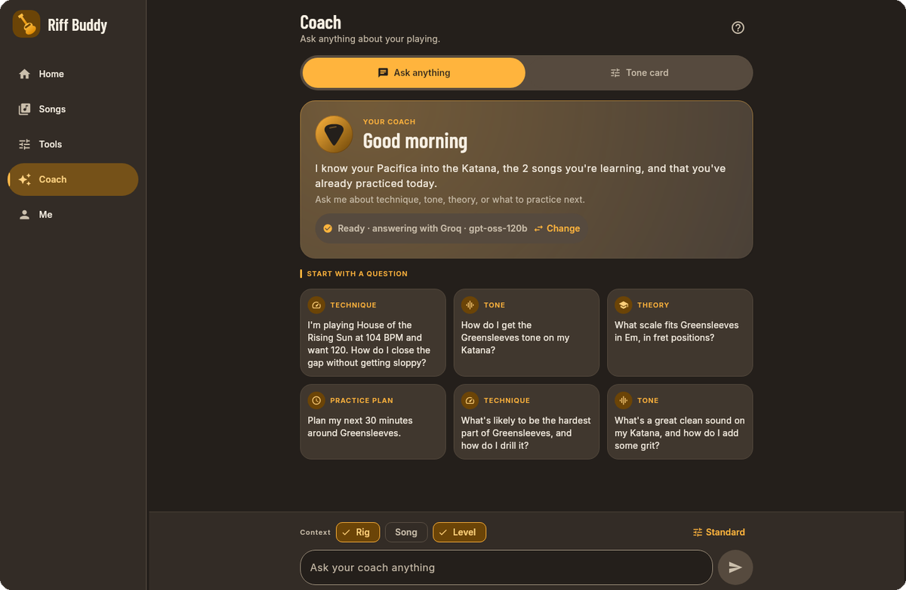
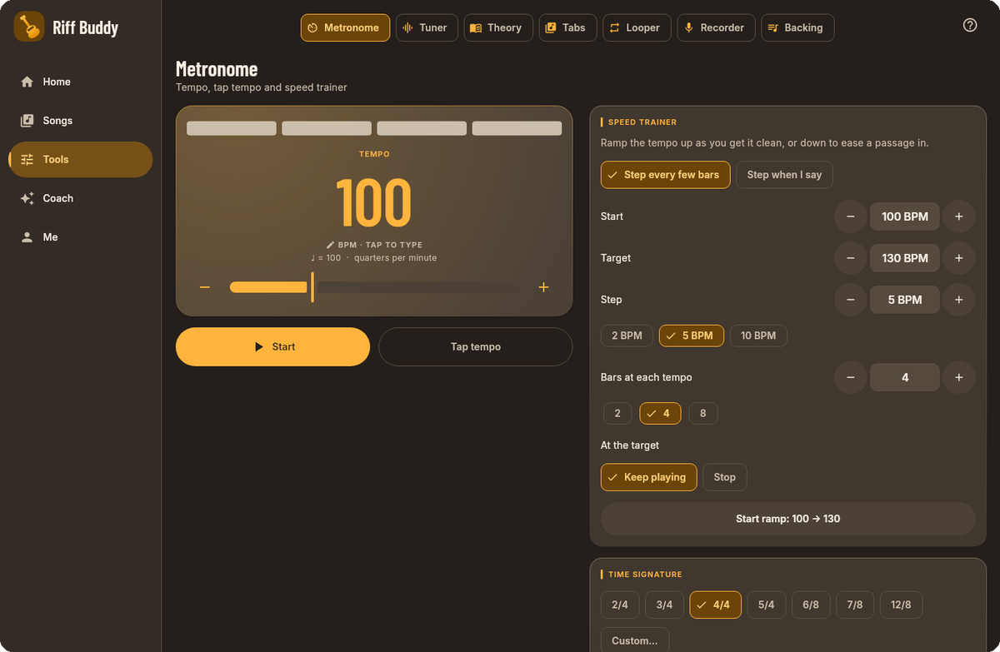
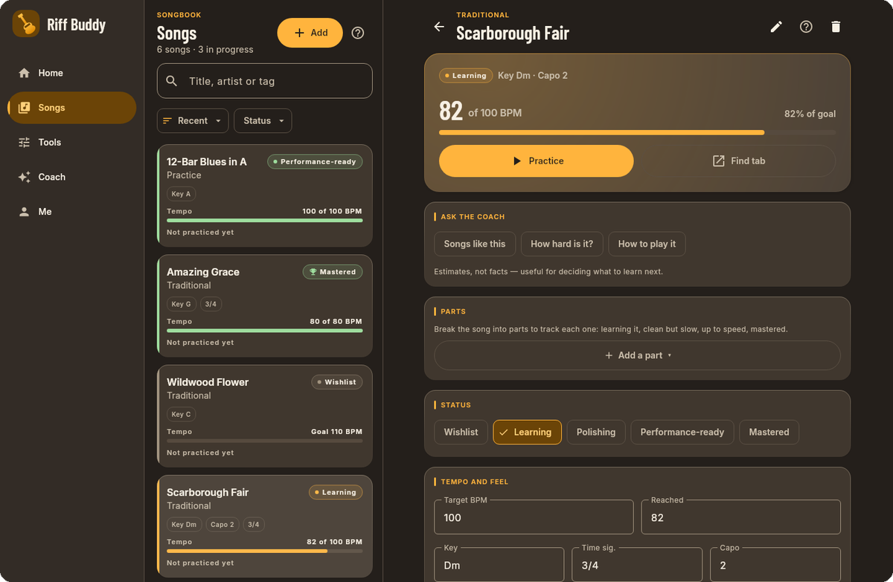
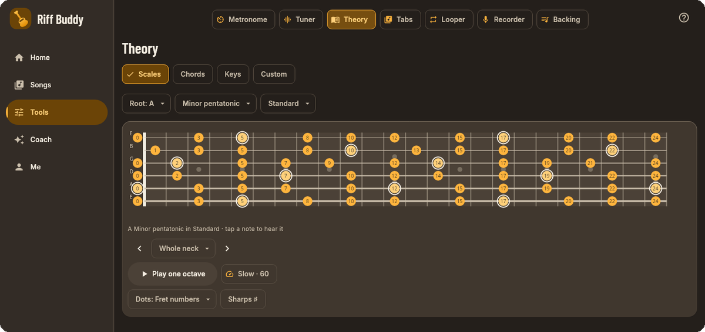
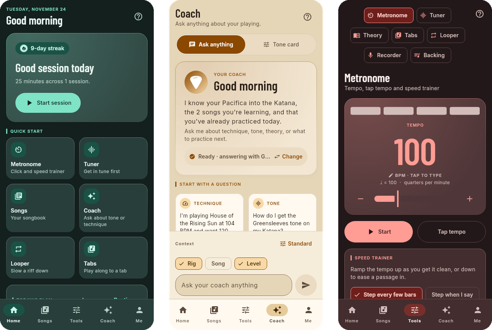
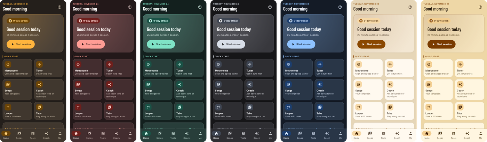

<div align="center">

# Riff Buddy

### Your practice buddy for every guitar player

Tune up, lock in with the click, loop the tricky bit, and watch yourself
get better. Whether you're learning your first three chords or tightening
up a set list, Riff Buddy is here to make practice the fun part.

## [Play now in your browser](https://stnkypnky.github.io/riffbuddy/)

**Free** · **No sign-up** · **Works offline** · **Phone, tablet or computer**



</div>

---

## What's in the case

### A coach in your corner
Ask anything: how to clean up a chord change, what to practice for the next
half hour, or where to set the knobs on *your* amp to get a song's tone. The
coach knows your guitar, your amp and the songs you're learning, and pitches
its answers at your level. Not sure what to ask? It starts you off with
ideas from your own songbook.



### A metronome that pushes you (gently)
Type any tempo, tap one in, or let the speed trainer creep it up a few BPM
every few bars until that riff is up to speed.



### A songbook that keeps score
Every song you're working on, from wishlist to mastered, with how close you
are to full speed, its key and capo, and a quick link to find the tab.



### Theory you can see (and hear)
Scales, chords and keys right on the neck, in fret numbers, not sheet music.
Step through the positions and tap **Play** to hear them.



### …and a whole pedalboard more
- **Tuner**, with a reference note for every string
- **Looper** that slows a song down without changing its pitch
- **Tab player** that plays along with you
- **Recorder** to hear how you really sound
- **Backing tracks** to jam over, in the key and tempo you pick
- **Streaks, routines, lessons and stats** to keep you coming back

### Made for your phone, too



### Pick your finish
Ten color schemes named after classic guitar finishes: Sunburst, Cherry,
Rosewood, Ebony, Mahogany, Surf Green and Lake Placid Blue, or go light with
Maple, Olympic White and Butterscotch. Find them in **Me › Settings ›
Appearance**.



---

## Get playing in 3 steps

### 1. Open it

Open **[Riff Buddy](https://stnkypnky.github.io/riffbuddy/)** in Chrome, Edge, Firefox or Safari. That's
it: no download, no account. The first visit saves the app on your device,
so after that it opens even with no internet. Allow the microphone when the
tuner or recorder asks.

**Want it on your home screen?** Install it from the browser and it gets its
own icon and window:
- **iPhone or iPad** (iOS 18.2 or newer): in Safari, tap **Share**, then
  **Add to Home Screen**, and open it from there. Installed, Safari keeps
  your practice; as a plain web page it may clear it after weeks unvisited.
- **Android:** Chrome › **⋮** › **Install app**.
- **Computer:** the install icon at the right of Chrome's or Edge's address bar.

A few things a browser can't do, and what Riff Buddy does instead:
- It can't sync with your other devices itself: **Export** a backup and
  **Import** it on the other device.
- Reminders come only while it's open, so **Add to my calendar** lets your
  calendar remind you.
- Takes are shared as WAV.

Rather have a regular app? See [Install an app (optional)](#install-an-app-optional).

### 2. Say hi (about 3 minutes, all skippable)

The first launch asks three quick things:

1. **About you:** how long you've played and what you're into, so the coach
   talks at your level.
2. **The coach:** an optional free AI key (see below).
3. **Your gear:** tap **+ Add** under Guitars, then under Amps. Type the make
   and model, tap **Fill in with the coach**, and it drafts the knobs, amp
   models and effects for you to check.

Skip anything you like and come back later in **Me › Settings**.

### 3. Play!

Start with **Tools**: tune up, start the click, then open **Theory**, pick a
scale and tap **Play** to hear it. Stuck anywhere? Every screen has a **?**
in the corner with answers for that screen.

> **Want the full tour?** The [illustrated guide (PDF)](docs/Riff-Buddy-Guide.pdf)
> walks through every screen.

---

## Install an app (optional)

The web app is the same app as these. Install one if you'd rather have it
outside the browser, or want nearby sync between your own devices.

### Android phone or tablet (about 5 minutes)

Riff Buddy isn't in the Play Store yet, so you install the app file yourself.
It's safe, and you only do this once.

1. On your phone or tablet, open this page (the repository, not the web
   app) and go to **Releases** (on the right, or under the file list on a
   phone).
2. Under the newest release, tap **`riff_buddy-release.apk`** to download it.
3. Open the download. Android says it can't install apps from this source:
   tap **Settings**, turn on **Allow from this source**, then go back.
   - *Fire tablet:* Settings › Security & Privacy › **Apps from Unknown Sources**.
4. Tap **Install**, then **Open**.

Needs Android 8.0 or newer (almost any phone or tablet from 2018 on).

### Windows, macOS or Linux

Under the newest release, download the file for your computer. The installers
aren't signed (signing costs money every year), so each system asks once
whether you trust it.

**Mac** (Apple Silicon: M1 or newer), **`Riff.Buddy-….dmg`**
1. Open the download and drag **Riff Buddy** into **Applications**.
2. Open it from Applications. macOS says it can't verify the app: click
   **Done**.
3. Open **System Settings › Privacy & Security**, scroll down to
   "Riff Buddy was blocked", click **Open Anyway**, and enter your password.
4. When it asks to use the microphone, click **Allow**: the tuner and
   recorder need it.

If macOS says the app **is damaged and can't be opened**, that's the same
warning in stronger words. Open **Terminal**, paste this line, press Return,
then open Riff Buddy again:

```sh
xattr -cr "/Applications/Riff Buddy.app"
```

**Windows**, **`Riff.Buddy-….msi`**
1. Open the download. If Windows says it protected your PC, click
   **More info**, then **Run anyway**.
2. It installs for you alone, with no administrator password, and adds
   Riff Buddy to the Start menu.

**Linux** (Debian, Ubuntu, Zorin, Mint), **`riffbuddy_…_amd64.deb`**
- Double-click it to open it in your software installer, or in a terminal:
  `sudo apt install ./riffbuddy_*_amd64.deb`. Riff Buddy appears in your
  applications menu.

**Bring your practice along:** with the phone or tablet on the same Wi-Fi,
open **Me › Settings › Sync with your other devices** on both, tap **Pair**,
check that both screens show the same six digits, then **Sync now**. (Or
**Export** a backup there, send the file to the computer, and drag it onto
the Riff Buddy window.) On a computer:
- The first time you sync, Windows or macOS may ask whether Riff Buddy can
  use the network: allow it on **private** networks.
- Your API keys go in the system's own keychain.
- Each screen has keyboard shortcuts, with Space for its main control:
  press **?** to see them. Escape goes back.
- The looper opens WAV, AIFF and MP3, but not M4A.
- Reminders show only while the app is open.

---

## The AI coach (free, optional)

Everything else in Riff Buddy works without it, but the coach is a lot of
fun. It writes **tone cards**: for a song and part, where to set every
knob on your amp, which amp model and effects to use, and which pickup to
play on. It also answers any practice question you throw at it.

It needs a free key from any **one** of these. None needs a credit card:

| Provider | Good for | Where to get a key |
|---|---|---|
| **Groq** (easiest start) | Its recommended model, `gpt-oss-120b`, is the smartest free one. About 1,000 requests a day. | [console.groq.com/keys](https://console.groq.com/keys) |
| **Gemini** (Google) | A good second key. About 200 a day. | [aistudio.google.com/apikey](https://aistudio.google.com/apikey) |
| **Mistral** | Free "Experiment" plan with its largest model. Asks to verify a phone number, and may use free-plan requests for training. | [console.mistral.ai/api-keys](https://console.mistral.ai/api-keys) |
| **OpenRouter** | 50 free requests a day across many free models. | [openrouter.ai/settings/keys](https://openrouter.ai/settings/keys) |

**How:** in the app, open **Me › Settings › AI coach**, tap **Add a key**
next to a provider, then **Get a free key**. It opens the right page. Sign
in, create a key, copy it, come back, paste it and tap **Save key**, then
**Test connection**.

With two keys, the coach switches to the other when one is busy. If a
provider suggests a smarter model, tap **Use it**.

**Paid providers, if you want them.** If you already pay for **Claude**
(Anthropic), **OpenAI** or **DeepSeek**, you can add that key too, under
**Paid providers** in the same settings. They bill your own account with
them, and they're never used unless you choose them: tap
**Ready · answering with …** (or **Change who answers…** in the coach's
options) to pick a provider and model. **Use paid providers as a fallback**
is off unless you turn it on.

---

## Your data and privacy

- **Everything stays on your device.** No account, no analytics, no ads.
- **Syncing goes only to devices you paired,** directly over your own Wi-Fi,
  encrypted. No cloud, no server.
- **The coach sends only what it needs:** the song's title and artist, the
  part, your tuning and your gear. Never your recordings, tab files, notes
  or practice history. **What I sent**, under any answer, shows the exact
  text. **Me › Settings › What leaves this device** explains it.
- **Keys are locked:** in Android's Keystore, the computer's keychain, or
  in the browser by a key that can't be copied out. They're never in a
  backup or the logs.
- **Back up** with **Me › Settings › Export**. It saves one `.riffbuddy`
  file with your songs, practice log, gear, tone cards, lessons, routines,
  tabs and recordings. **Import** brings it back on any device. (API keys
  aren't included: paste them again.)

---

## Help

| Problem | Try this |
|---|---|
| "App not installed" / "conflicts with an existing package" | You have a copy signed differently. **Export** a backup first, uninstall the old copy, install, then **Import**. |
| The tuner doesn't move | Allow the microphone: Android Settings › Apps › Riff Buddy › Permissions. |
| The coach says there's no key, or it's busy | Add a key (above), or a second provider as a backup. Free limits reset daily. |
| "Fill in with the coach" isn't sure about my amp | Check the draft against your amp and edit anything that's off. Nothing saves until you tap **Save**. |
| No sound from Play or the metronome | Turn up the **media** volume (not the ringer), and check that Bluetooth isn't sending the sound elsewhere. |
| Mac: the tuner doesn't move | System Settings › Privacy & Security › **Microphone**: turn on Riff Buddy, then reopen it. |
| My other device isn't listed for syncing | Open Riff Buddy on both, on the same Wi-Fi. Some routers keep devices apart: tap **Not listed? Type its address** and enter the address the other device shows. |
| Computer: the tuner hears the wrong thing | On the **Recorder**, pick the input you play into, such as a USB microphone or your amp's USB. |

Still stuck? Tap **?** on the screen you're on. Most questions are answered
there, and **Ask the Coach** takes it from there.

**Now go play something.**

---

## For developers

Native Android: Kotlin and Jetpack Compose, minSdk 26. The module is in
`riff_buddy/`.

```sh
# Needs JDK 21 and the Android SDK (platform 37). Point Gradle at the SDK once:
echo "sdk.dir=$HOME/Android/Sdk" > local.properties

./gradlew :riff_buddy:assembleDebug          # debug APK → riff_buddy/build/outputs/apk/debug/
./gradlew :riff_buddy:testDebugUnitTest      # unit tests
./gradlew :riff_buddy:lintDebug              # lint
```

The desktop edition is in `riff_buddy/desktop/`. It compiles the same
shared code (`riff_buddy/shared/`) with Compose Multiplatform, and needs
only JDK 21, not the Android SDK:

```sh
export RIFFBUDDY_DESKTOP_ONLY=1              # skip the Android app
./gradlew :desktop:run                       # run it
./gradlew :desktop:test                      # the shared tests, on a plain JVM
./gradlew :desktop:packageDeb                # or packageMsi / packageDmg, on that system
```

Pushing a `v*` tag builds all three installers on GitHub Actions
(`.github/workflows/desktop.yml`) into a draft release.

The web edition is in `riff_buddy/web/`: the same shared code compiled to
WebAssembly with Compose for Web, also needing only JDK 21:

```sh
export RIFFBUDDY_WEB_ONLY=1                  # skip the Android app
./gradlew :web:wasmJsBrowserDistribution     # the site → riff_buddy/web/build/dist/wasmJs/productionExecutable/
# Serve that folder on localhost (for example python3 -m http.server) and open it.
```

A `v*` tag also publishes the web edition to GitHub Pages
(`.github/workflows/web.yml`), once Pages is set to deploy from GitHub
Actions in the repository's settings.

A signed release build needs a `keystore.properties` in the project root
(`storeFile`, `storePassword`, `keyAlias`, `keyPassword`). It and the
keystore are git-ignored; never commit them. Every bundled asset and library
is listed with its license in [`riff_buddy/LICENSES.md`](riff_buddy/LICENSES.md).
